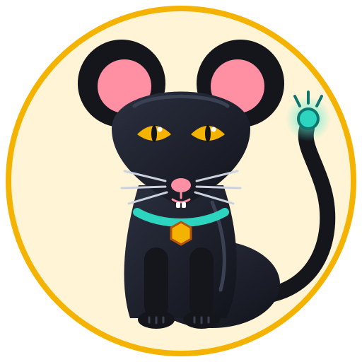
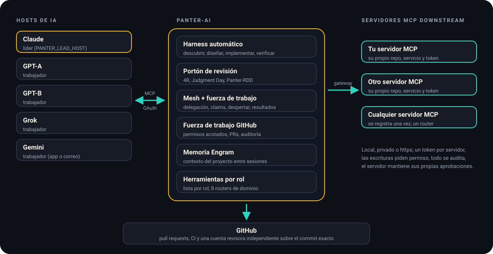
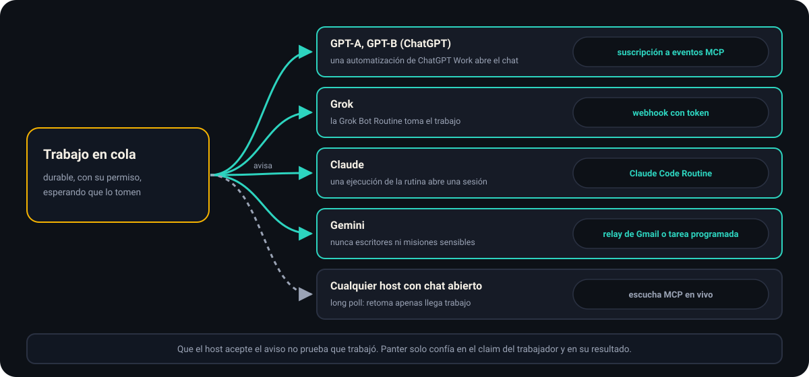
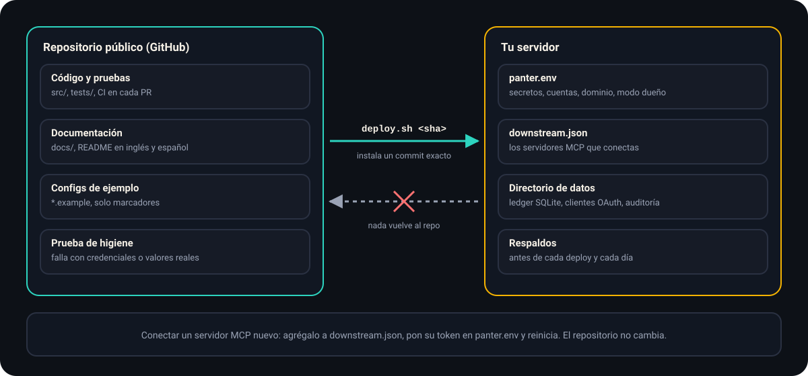

<p align="center">
  
</p>

<p align="center">
  
</p>

<p align="center">
  <a href="README.md">English</a> · <b>Español</b>
</p>

<p align="center">
  <a href="LICENSE">MIT</a> ·
  <a href="CHANGELOG.md">Changelog</a> ·
  <a href="docs/SELF_HOSTING.md">Tu propia instancia</a> ·
  <a href="docs/OWNER_MODE.md">Modo dueño</a> ·
  <a href="docs/CANONICAL_HARNESS_POLICY.md">Política</a> ·
  <a href="docs/DOWNSTREAM_MCP.md">MCP downstream</a>
</p>

# Panter-ai

**Panter-ai es un servidor MCP de código abierto que convierte varias apps de IA en un solo equipo de ingeniería.** Una app lidera: planifica y reparte el trabajo. Las demás toman ese trabajo (explorar, implementar, verificar, revisar) y devuelven resultados. Panter guarda el plan, los permisos y la evidencia en un registro durable, para que nadie tenga que creerle a un modelo que algo quedó hecho.

**Panter nunca llama a una API de modelos.** Cada app (Claude, ChatGPT, Grok, Gemini) se conecta con su propia cuenta y usa su propio modelo. El servidor no guarda API keys de modelos ni ejecuta inferencia: coordina, registra y controla.

**Para quién es:** para quien ya usa varias apps de IA y quiere que trabajen en los mismos proyectos con roles claros, pull requests reales en GitHub y una revisión independiente antes de mergear cualquier cosa.

## Conoce a Panter

La mascota es una pantera con cara de ratón. La pantera es paciente y precisa, y no suelta un trabajo hasta terminarlo. El ratón es chico y curioso, y se mete en todos los rincones. Su cola termina en un conector, porque así funciona Panter: cada app y cada servidor MCP se enchufa a él.

<p align="center">
  
</p>

## Cómo encaja todo

<p align="center">
  
</p>

- **Hosts de IA** (las apps): se conectan a `https://<tu-dominio>/mcp` con OAuth. Apruebas cada una en una pantalla de consentimiento y la amarras a un nombre de host: `claude`, `gpt-a`, `gpt-b`, `grok` o `gemini`. `PANTER_LEAD_HOST` define el líder; los demás hosts son trabajadores.
- **Panter-ai** maneja el trabajo: elige la siguiente fase, se la manda a un host que pueda hacerla, registra lo que vuelve y no avanza sin evidencia.
- **Servidores MCP downstream** (tus propias herramientas, cada una en su repositorio y servicio): quedan detrás de Panter. Los hosts llegan a ellos por un solo gateway, con un token por servidor, permisos de escritura y un registro de auditoría.
- **GitHub** es donde aterriza el trabajo: pull requests, CI y una cuenta revisora independiente que aprueba el commit exacto.

## Cómo fluye una tarea

<p align="center">
  
</p>

1. **El líder delega.** Llama a `panter_harness_tick`, y el harness automático elige la fase, o delega directo con `panter_mesh_delegate`.
2. **Panter lo encola** como trabajo durable. Si el trabajo toca GitHub, le asigna un permiso acotado a ese trabajo y a un solo repositorio.
3. **Panter despierta al trabajador** por la ruta que soporta su app (siguiente sección).
4. **El trabajador lo toma** con un lease exclusivo y latidos, así un solo intento es dueño del trabajo.
5. **El trabajador hace el trabajo en su propia app.** En GitHub hace commits en una rama nueva, `panter/<host>-<id>`, y abre un pull request.
6. **Termina con evidencia.** Panter guarda el resultado, le manda un recibo al líder y revoca el permiso de GitHub.
7. **Revisión y merge.** El CI y un revisor independiente revisan el commit exacto; el líder mergea.

Si un trabajador no toma el trabajo a tiempo (3 minutos por defecto, 20 por correo), la fase del harness vuelve al líder, que la hace él mismo. Un trabajador dormido nunca frena una corrida.

## Cómo se despierta a los trabajadores

<p align="center">
  
</p>

| Host | Cómo lo despierta Panter | Configuración |
|---|---|---|
| GPT-A, GPT-B (ChatGPT) | Suscripción a eventos MCP que dispara una automatización de ChatGPT Work | [CHATGPT_NATIVE_MCP_EVENTS.md](docs/CHATGPT_NATIVE_MCP_EVENTS.md) |
| Grok | Webhook con token a su Grok Bot Routine | [GROK_BOT_WAKE.md](docs/GROK_BOT_WAKE.md) |
| Claude | Claude Code Routine | [CLAUDE_ROUTINE_WAKE.md](docs/CLAUDE_ROUTINE_WAKE.md) |
| Gemini | Relay de Gmail o tarea programada (nunca escritores ni misiones sensibles) | [GEMINI_MAIL_WAKE.md](docs/GEMINI_MAIL_WAKE.md) |
| Cualquier host con un chat abierto | Escucha MCP en vivo (long poll) | [WORKFORCE_WAKE.md](docs/WORKFORCE_WAKE.md) |

Que el host acepte el aviso no prueba que trabajó. Panter solo confía en el claim del trabajador y en su resultado. `panter_workforce_status` muestra cómo despertar a cada trabajador y qué terminó en las últimas 24 horas.

## Revisiones y portón de entrega

<p align="center">
  
</p>

- **Revisión 4R:** cuatro lentes (riesgo, legibilidad, confiabilidad y resiliencia), en el líder o en los hosts asignados a cada lente.
- **Judgment Day** (si se pide): dos jueces ciegos, nunca en un host que escribió el candidato.
- **Panter-RDD:** solo reconoce una revisión amarrada al commit exacto, a su CI y a transportes atestiguados.
- **Cuenta revisora independiente:** una segunda cuenta de GitHub, configurada en `PANTER_GITHUB_INDEPENDENT_REVIEWER`, que da la aprobación formal sobre el commit exacto. Ver [INDEPENDENT_REVIEW_IDENTITY.md](docs/INDEPENDENT_REVIEW_IDENTITY.md).

Una revisión nunca da permiso para mergear ni desplegar. Eso queda en manos del líder y de quien opera la instancia.

### Modo dueño

Si todas las apps conectadas son tuyas, activa `PANTER_OWNER_MODE=1` ([OWNER_MODE.md](docs/OWNER_MODE.md)):

- el líder delega escritores directo, sin permiso de operador, y un escritor puede trabajar sobre todo el repositorio;
- los despertares aceptan escritores, y el trabajo queda en cola detrás de un trabajador ocupado en vez de rechazarse;
- `panter_mesh_delegate_auto` elige al trabajador alcanzable con menos carga;
- el riesgo por palabras clave pasa a ser un aviso;
- el portón de entrega convierte las convenciones en avisos y sigue bloqueando por el commit exacto, el PR, la base, el CI y el revisor independiente, que el modo dueño exige.

Los límites de los trabajadores del diagrama nunca cambian.

## Tu repositorio y tu servidor

<p align="center">
  
</p>

Este repositorio es genérico: no trae cuentas, dominios, tokens ni contraseñas de ninguna instalación. Todo lo tuyo vive en tu servidor:

| Archivo | Qué guarda |
|---|---|
| `panter.env` | secretos, cuentas, dominio, líder, modo dueño, despertares |
| `downstream.json` | los servidores MCP que conectas detrás de Panter |
| directorio de datos | ledger SQLite, clientes y tokens OAuth, auditoría |
| respaldos | antes de cada deploy y cada día |

Para conectar un servidor MCP nuevo: agrégalo a `downstream.json`, pon su token en `panter.env` y reinicia. El repositorio no cambia. Una prueba de higiene en el CI falla si un archivo versionado trae una credencial real o si una configuración de ejemplo trae un valor real. Paso a paso: [SELF_HOSTING.md](docs/SELF_HOSTING.md).

## Qué hace

| Área | Qué obtienes |
|---|---|
| **Harness automático** | `panter_harness_start` y `panter_harness_tick` corren fases ODD (descubrir, diseñar, implementar, verificar, revisar) elegidas según el riesgo. El usuario nunca elige agentes ni skills. `panter_harness_close` detiene una corrida para siempre. |
| **Portón de revisión** | 4R con cuatro lentes, Judgment Day opcional con dos jueces ciegos, y Panter-RDD amarrado al commit exacto, su CI y transportes atestiguados. |
| **Mesh y fuerza de trabajo** | Delegación durable, claims con lease exclusivo, latidos, resultados, rutas de despertar, plazos con vuelta al líder y `panter_mesh_withdraw` para retirar trabajo en cola que nadie empezó. |
| **Fuerza de trabajo en GitHub** | Acceso de escritura acotado a un trabajo y un repositorio: leer, hacer commits en su propia rama nueva, abrir un PR, comentar, abrir un issue. Se revoca al terminar y queda auditado. |
| **Memoria** | Memoria de proyecto Engram opcional, espejada desde el ledger del harness. |
| **Herramientas por rol** | Cada rol ve una lista corta: el líder 50 herramientas y un trabajador 31, contando los 8 routers de dominio. Todas se pueden llamar por nombre o por su router. Ver [TOOL_SURFACE.md](docs/TOOL_SURFACE.md). |
| **Gateway downstream** | Registras un servidor MCP una vez y aparece como un router, `panter_ds_<nombre>`, con timeouts, circuit breaker, permisos de escritura, identidad firmada del actor en cada llamada, credenciales OAuth de cliente, servidores `sensitive` que no guardan contenido y auditoría. Ver [DOWNSTREAM_MCP.md](docs/DOWNSTREAM_MCP.md). |
| **Operación** | Deploy de un commit exacto con un comando y vuelta atrás automática, respaldo con prueba de restauración antes de cada deploy y cada día, y un healthcheck cada 5 minutos que reinicia el servicio. Ver [OPERATIONS.md](docs/OPERATIONS.md). |

## Reglas básicas

Se hacen cumplir en el código, no solo en los docs:

- **Sin APIs de modelos.** El servidor nunca ejecuta inferencia ni guarda API keys de modelos.
- **Evidencia, no promesas.** Si un host dice "pasan las pruebas", queda como reportado, no como verificado. Aprobar exige el commit exacto, CI y un revisor independiente.
- **La autorización va aparte.** Escribir código, mergear y desplegar necesitan cada uno su propia autorización. Una revisión nunca la da.
- **Cada trabajador en lo suyo.** Nunca mergea, aprueba, hace push forzado, escribe la rama principal o ramas protegidas, el CI o la configuración de git, ni lee secretos.
- **El modelo lo pone el host.** Panter *pide* un modelo, un esfuerzo y paralelismo ([`src/core/policy.ts`](src/core/policy.ts)); nunca afirma lo que el host ejecutó de verdad.

## Inicio rápido

Requiere Node.js 22.16 o superior.

```sh
npm ci
npm run build
npm test
export PANTER_TOKEN="$(node -e "process.stdout.write(require('node:crypto').randomBytes(32).toString('hex'))")"
npm start
```

El servidor escucha en `127.0.0.1:8080/mcp` en modo `dev-static`: manda `Authorization: Bearer $PANTER_TOKEN`. Ese modo es solo para pruebas locales; nunca lo expongas.

Para apps reales, usa el OAuth integrado (`PANTER_AUTH_MODE=embedded`, ver [OAUTH_EMBEDDED.md](docs/OAUTH_EMBEDDED.md)) detrás de un proxy con TLS:

1. Agrega `https://<tu-dominio>/mcp` como conector MCP personalizado en cada app.
2. Apruébalo en la pantalla de consentimiento de Panter con tu `PANTER_CONSENT_PASSWORD` y elige su nombre de host.
3. Todas las variables están en [`deploy/panter.env.example`](deploy/panter.env.example).

`GET /health` responde `{"status":"ok","name":"panter-ai","version":"…","revision":"<commit>"}` (`revision` es `null` fuera de una release instalada con `deploy/deploy.sh`).

## En producción

La instalación de referencia es una sola VM ARM64 con un servicio `systemd --user` detrás de un túnel de Cloudflare:

```sh
PANTER_SOURCE_REPO=<clon de este repo> ~/panter-ai/current/deploy/deploy.sh <sha completo de un commit en main>
```

El script compila y prueba ese commit, detiene el servicio para un respaldo consistente, cambia a la versión nueva y vuelve atrás solo si `/health` no reporta ese commit. La vuelta atrás cubre el código, no los datos (si una versión cambió los datos, se restaura el respaldo previo al deploy), y el primer deploy no tiene versión anterior a la cual volver. Respaldos, restauración y timers en [OPERATIONS.md](docs/OPERATIONS.md). La imagen Docker para ARM64 está en [ORACLE_ARM.md](docs/ORACLE_ARM.md).

Panter guarda su estado en un ledger SQLite y unos pocos archivos JSON. Corre **un solo proceso** por directorio de datos.

## Documentación

| Tema | Leer |
|---|---|
| Reglas que mandan sobre todo lo demás | [CANONICAL_HARNESS_POLICY.md](docs/CANONICAL_HARNESS_POLICY.md) |
| Tu propia instancia | [SELF_HOSTING.md](docs/SELF_HOSTING.md), [OWNER_MODE.md](docs/OWNER_MODE.md) |
| Líder y trabajadores | [LEADERSHIP.md](docs/LEADERSHIP.md), [HARNESS_HOSTS.md](docs/HARNESS_HOSTS.md) |
| El harness | [AUTOMATIC_HARNESS.md](docs/AUTOMATIC_HARNESS.md) |
| Revisiones | [PANTER_RDD_NATIVE.md](docs/PANTER_RDD_NATIVE.md), [INDEPENDENT_REVIEW_IDENTITY.md](docs/INDEPENDENT_REVIEW_IDENTITY.md) |
| GitHub | [GITHUB_WORKFORCE.md](docs/GITHUB_WORKFORCE.md), [GITHUB_GENTLE_WORKFLOW.md](docs/GITHUB_GENTLE_WORKFLOW.md) |
| Despertar hosts | [WORKFORCE_WAKE.md](docs/WORKFORCE_WAKE.md), [CHATGPT_NATIVE_MCP_EVENTS.md](docs/CHATGPT_NATIVE_MCP_EVENTS.md), [GROK_BOT_WAKE.md](docs/GROK_BOT_WAKE.md), [CLAUDE_ROUTINE_WAKE.md](docs/CLAUDE_ROUTINE_WAKE.md), [GEMINI_MAIL_WAKE.md](docs/GEMINI_MAIL_WAKE.md) |
| Herramientas y routers | [TOOL_SURFACE.md](docs/TOOL_SURFACE.md) |
| Servidores MCP downstream | [DOWNSTREAM_MCP.md](docs/DOWNSTREAM_MCP.md) |
| Login y consentimiento | [OAUTH_EMBEDDED.md](docs/OAUTH_EMBEDDED.md) |
| Operación | [OPERATIONS.md](docs/OPERATIONS.md), [ORACLE_ARM.md](docs/ORACLE_ARM.md) |
| Historia (v0.1 a v0.15) | [HISTORY.md](docs/HISTORY.md) |

La mayoría de las guías de `docs/` está en inglés o en español; este README está en los dos idiomas.

## Contribuir

Ver [CONTRIBUTING.md](CONTRIBUTING.md). Los hosts y agentes que trabajan en este repositorio siguen [AGENTS.md](AGENTS.md).

Las imágenes de `docs/assets` salen de [scripts/brand](scripts/brand/README.md): cambia el texto ahí y regenera en vez de editar los SVG a mano.

## Licencia

MIT. Ver [LICENSE](LICENSE). Los agentes y skills de Gentle Shell en `vendor/gentle-shell` mantienen sus propios avisos MIT.
