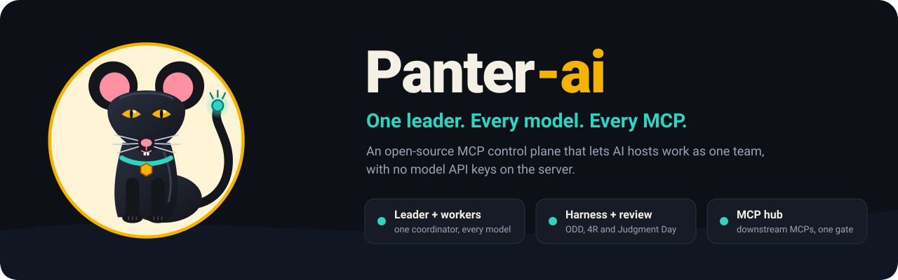
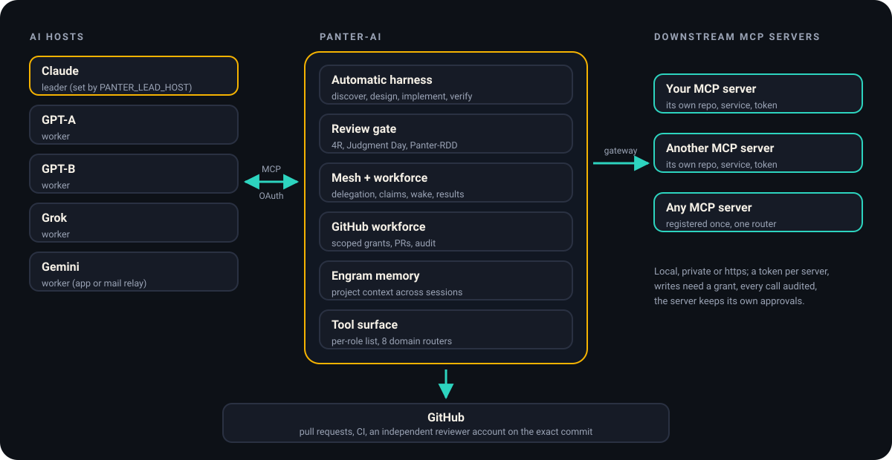
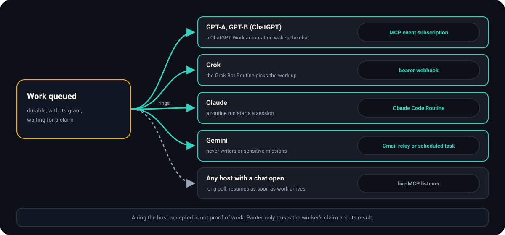
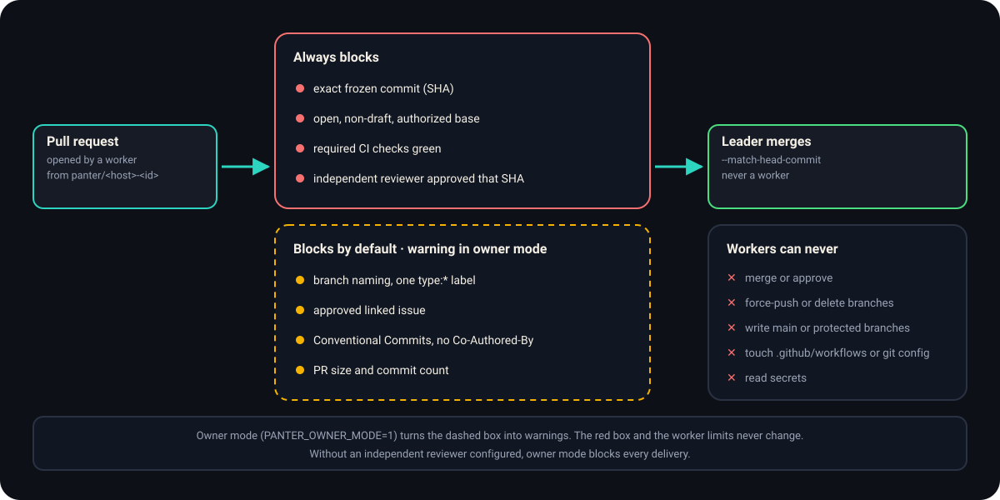
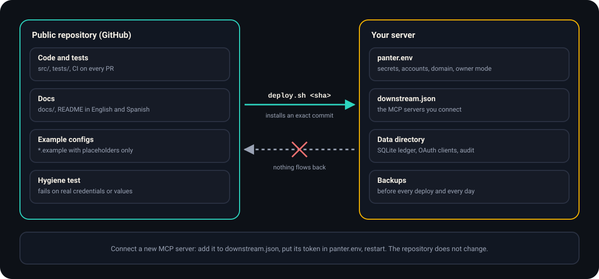

<p align="center">
  
</p>

<p align="center">
  <b>English</b> · <a href="README.es.md">Español</a>
</p>

<p align="center">
  <a href="LICENSE">MIT</a> ·
  <a href="CHANGELOG.md">Changelog</a> ·
  <a href="docs/SELF_HOSTING.md">Self-hosting</a> ·
  <a href="docs/OWNER_MODE.md">Owner mode</a> ·
  <a href="docs/CANONICAL_HARNESS_POLICY.md">Policy</a> ·
  <a href="docs/DOWNSTREAM_MCP.md">Downstream MCPs</a>
</p>

# Panter-ai

**Panter-ai is an open-source MCP server that turns several AI apps into one engineering team.** One app leads: it plans and hands out the work. The others take that work (exploring, implementing, verifying, reviewing) and send back results. Panter keeps the plan, the permissions and the evidence in one durable ledger, so nobody has to take a model's word that something was done.

**Panter never calls a model API.** Each app (Claude, ChatGPT, Grok, Gemini) connects with its own account and runs its own model. The server holds no model API keys and runs no inference: it coordinates, records and gates.

**Who it is for:** anyone who already uses several AI apps and wants them to work on the same projects with clear roles, real GitHub pull requests and an independent review before anything is merged.

## Meet Panter

The mascot is a panther with a mouse's face. The panther is patient and precise and does not let go of a job until it is done. The mouse is small and curious and gets into every corner. Its tail ends in a connector node, because that is how Panter works: every app and every MCP server plugs into it.

<p align="center">
  
</p>

## How it fits together

<p align="center">
  
</p>

- **AI hosts** (the apps) connect to `https://<your-domain>/mcp` with OAuth. You approve each one on a consent screen and bind it to a host name: `claude`, `gpt-a`, `gpt-b`, `grok` or `gemini`. `PANTER_LEAD_HOST` picks the leader; every other host is a worker.
- **Panter-ai** runs the work. It picks the next phase, sends it to a host that can do it, records what came back and refuses to move on without evidence.
- **Downstream MCP servers** (your own tools, each in its own repository and service) sit behind Panter. Hosts reach them through one gateway, with a token per server, write grants and an audit log.
- **GitHub** is where work lands: pull requests, CI and an independent reviewer account approving the exact commit.

## How a task flows

<p align="center">
  
</p>

1. **The leader delegates.** It calls `panter_harness_tick` (the automatic harness picks the phase) or delegates directly with `panter_mesh_delegate`.
2. **Panter queues it** as a durable work item and, if the work touches GitHub, attaches a permission scoped to that one item and one repository.
3. **Panter wakes the worker** through the route its app supports (next section).
4. **The worker claims it** with a fenced lease and heartbeats, so only one attempt ever owns the work.
5. **The worker does the work in its own app.** On GitHub it commits to a new branch, `panter/<host>-<id>`, and opens a pull request.
6. **It completes with evidence.** Panter stores the result, sends the leader a receipt and revokes the GitHub permission.
7. **Review and merge.** CI and an independent reviewer check the exact commit; the leader merges.

If a worker does not pick the work up in time (3 minutes by default, 20 for mail), a harness phase falls back to the leader, which does it natively. A sleeping worker never blocks a run.

## How workers wake up

<p align="center">
  
</p>

| Host | How Panter wakes it | Setup |
|---|---|---|
| GPT-A, GPT-B (ChatGPT) | MCP event subscription that triggers a ChatGPT Work automation | [CHATGPT_NATIVE_MCP_EVENTS.md](docs/CHATGPT_NATIVE_MCP_EVENTS.md) |
| Grok | Bearer webhook to its Grok Bot Routine | [GROK_BOT_WAKE.md](docs/GROK_BOT_WAKE.md) |
| Claude | Claude Code Routine | [CLAUDE_ROUTINE_WAKE.md](docs/CLAUDE_ROUTINE_WAKE.md) |
| Gemini | Gmail relay or a scheduled task (never writers or sensitive missions) | [GEMINI_MAIL_WAKE.md](docs/GEMINI_MAIL_WAKE.md) |
| Any host with a chat open | Live MCP listener (long poll) | [WORKFORCE_WAKE.md](docs/WORKFORCE_WAKE.md) |

A ring the host accepted is not proof of work. Panter only trusts the worker's claim and its result. `panter_workforce_status` shows each worker's wake routes and what it finished in the last 24 hours.

## Reviews and the delivery gate

<p align="center">
  
</p>

- **4R review:** four lenses (risk, readability, reliability, resilience), run natively or on the hosts bound to them.
- **Judgment Day** (on request): two blind judges, never on a host that wrote the candidate.
- **Panter-RDD:** acknowledges a review only when it is bound to the exact commit, its CI and attested transports.
- **Independent reviewer account:** a second GitHub account, set in `PANTER_GITHUB_INDEPENDENT_REVIEWER`, gives the formal approval on the exact head commit. See [INDEPENDENT_REVIEW_IDENTITY.md](docs/INDEPENDENT_REVIEW_IDENTITY.md).

A review never grants permission to merge or deploy. Those stay with the leader and its operator.

### Owner mode

If you operate every connected app yourself, set `PANTER_OWNER_MODE=1` ([OWNER_MODE.md](docs/OWNER_MODE.md)):

- the leader delegates writers directly, without an operator write grant, and a writer may cover the whole repository;
- wake routes accept writers, and work queues behind a busy worker instead of being refused;
- `panter_mesh_delegate_auto` picks the least-loaded reachable worker;
- keyword-based risk becomes advice;
- the delivery gate turns process conventions into warnings and keeps blocking on the exact commit, the PR, the base, CI and the independent reviewer (which owner mode requires).

The worker limits in the diagram never change.

## Your repository and your server

<p align="center">
  
</p>

This repository is generic: no accounts, domains, tokens or passwords of any deployment. Everything that is yours lives on your server:

| File | What it holds |
|---|---|
| `panter.env` | secrets, accounts, domain, leader, owner mode, wake routes |
| `downstream.json` | the MCP servers you connect behind Panter |
| data directory | SQLite ledger, OAuth clients and tokens, audit |
| backups | taken before every deploy and every day |

To connect a new MCP server, add it to `downstream.json`, put its token in `panter.env` and restart. The repository does not change. A CI hygiene test fails if a tracked file carries a real credential or an example config carries a real value. Step-by-step setup: [SELF_HOSTING.md](docs/SELF_HOSTING.md).

## What it does

| Area | What you get |
|---|---|
| **Automatic harness** | `panter_harness_start` and `panter_harness_tick` run ODD phases (discover, design, implement, verify, review) chosen by risk. The user never picks agents or skills. `panter_harness_close` stops a run for good. |
| **Review gate** | 4R with four lenses, optional Judgment Day with two blind judges, and Panter-RDD bound to the exact commit, its CI and attested transports. |
| **Mesh and workforce** | Durable delegation, fenced claims with leases, heartbeats, results, wake routes, pickup timeouts with native fallback, and `panter_mesh_withdraw` for queued work nobody started. |
| **GitHub workforce** | Write access scoped to one work item and one repository: read, commit to its own new branch, open a PR, comment, open an issue. Revoked when the work ends, with an audit trail. |
| **Memory** | Optional Engram project memory, mirrored from the harness ledger. |
| **Tool surface** | Each role sees a short list: the leader 50 tools and a worker 31, the 8 domain routers included. Every tool stays callable by name or through its router. See [TOOL_SURFACE.md](docs/TOOL_SURFACE.md). |
| **Downstream gateway** | Register an MCP server once; it appears as one router, `panter_ds_<name>`, with timeouts, a circuit breaker, write grants, a signed actor identity on every call, OAuth client credentials, `sensitive` servers that keep no content, and an audit log. See [DOWNSTREAM_MCP.md](docs/DOWNSTREAM_MCP.md). |
| **Operations** | One-command deploy of an exact commit with automatic rollback, a backup with a restore check before every deploy and every day, and a health check every 5 minutes that restarts the service. See [OPERATIONS.md](docs/OPERATIONS.md). |

## Ground rules

These are enforced in code, not just written down:

- **No model APIs.** The server never runs inference and stores no model API keys.
- **Evidence over claims.** A host saying "tests pass" is recorded as reported, not verified. Approval needs the exact commit, CI and an independent reviewer.
- **Authorization is separate.** Writing code, merging and deploying each need their own authorization. Reviews never grant them.
- **Workers stay in their lane.** They never merge, approve, force-push, write the default or protected branches, CI or git config files, or read secrets.
- **The host owns the model.** Panter *requests* a model, effort and parallelism ([`src/core/policy.ts`](src/core/policy.ts)); it never claims what a host actually ran.

## Quick start

Requires Node.js 22.16 or later.

```sh
npm ci
npm run build
npm test
export PANTER_TOKEN="$(node -e "process.stdout.write(require('node:crypto').randomBytes(32).toString('hex'))")"
npm start
```

The server listens on `127.0.0.1:8080/mcp` in `dev-static` mode: send `Authorization: Bearer $PANTER_TOKEN`. That mode is for local tests only; never expose it.

For real apps, use embedded OAuth (`PANTER_AUTH_MODE=embedded`, see [OAUTH_EMBEDDED.md](docs/OAUTH_EMBEDDED.md)) behind a TLS proxy:

1. Add `https://<your-domain>/mcp` as a custom MCP connector in each app.
2. Approve it on Panter's consent screen with your `PANTER_CONSENT_PASSWORD` and choose its host name.
3. Every setting is listed in [`deploy/panter.env.example`](deploy/panter.env.example).

`GET /health` returns `{"status":"ok","name":"panter-ai","version":"…","revision":"<commit>"}` (`revision` is `null` outside a release installed by `deploy/deploy.sh`).

## Running it in production

The reference deployment is a single ARM64 VM running a `systemd --user` service behind a Cloudflare tunnel:

```sh
PANTER_SOURCE_REPO=<clone of this repo> ~/panter-ai/current/deploy/deploy.sh <full commit sha on main>
```

The script builds and tests that commit, stops the service for a consistent backup, switches to it, and rolls back on its own if `/health` does not report that commit. The rollback covers code, not data (restore from the pre-deploy backup if a release changed it), and the very first deploy has no previous release to go back to. Backups, restore steps and the timers are in [OPERATIONS.md](docs/OPERATIONS.md). A Docker image for ARM64 is described in [ORACLE_ARM.md](docs/ORACLE_ARM.md).

Panter keeps its state in one SQLite ledger plus a few JSON stores. Run **one process** per data directory.

## Documentation

| Topic | Read |
|---|---|
| Rules that win over everything else | [CANONICAL_HARNESS_POLICY.md](docs/CANONICAL_HARNESS_POLICY.md) |
| Your own instance | [SELF_HOSTING.md](docs/SELF_HOSTING.md), [OWNER_MODE.md](docs/OWNER_MODE.md) |
| Leader and workers | [LEADERSHIP.md](docs/LEADERSHIP.md), [HARNESS_HOSTS.md](docs/HARNESS_HOSTS.md) |
| The harness | [AUTOMATIC_HARNESS.md](docs/AUTOMATIC_HARNESS.md) |
| Reviews | [PANTER_RDD_NATIVE.md](docs/PANTER_RDD_NATIVE.md), [INDEPENDENT_REVIEW_IDENTITY.md](docs/INDEPENDENT_REVIEW_IDENTITY.md) |
| GitHub | [GITHUB_WORKFORCE.md](docs/GITHUB_WORKFORCE.md), [GITHUB_GENTLE_WORKFLOW.md](docs/GITHUB_GENTLE_WORKFLOW.md) |
| Waking hosts | [WORKFORCE_WAKE.md](docs/WORKFORCE_WAKE.md), [CHATGPT_NATIVE_MCP_EVENTS.md](docs/CHATGPT_NATIVE_MCP_EVENTS.md), [GROK_BOT_WAKE.md](docs/GROK_BOT_WAKE.md), [CLAUDE_ROUTINE_WAKE.md](docs/CLAUDE_ROUTINE_WAKE.md), [GEMINI_MAIL_WAKE.md](docs/GEMINI_MAIL_WAKE.md) |
| Tools and routers | [TOOL_SURFACE.md](docs/TOOL_SURFACE.md) |
| Downstream MCP servers | [DOWNSTREAM_MCP.md](docs/DOWNSTREAM_MCP.md) |
| Login and consent | [OAUTH_EMBEDDED.md](docs/OAUTH_EMBEDDED.md) |
| Operations | [OPERATIONS.md](docs/OPERATIONS.md), [ORACLE_ARM.md](docs/ORACLE_ARM.md) |
| History (v0.1 to v0.15) | [HISTORY.md](docs/HISTORY.md) |

Most guides under `docs/` are written in English or Spanish; this README is available in both.

## Contributing

See [CONTRIBUTING.md](CONTRIBUTING.md). Hosts and agents working in this repository follow [AGENTS.md](AGENTS.md).

## License

MIT. See [LICENSE](LICENSE). The Gentle Shell agents and skills in `vendor/gentle-shell` keep their own MIT notices.
